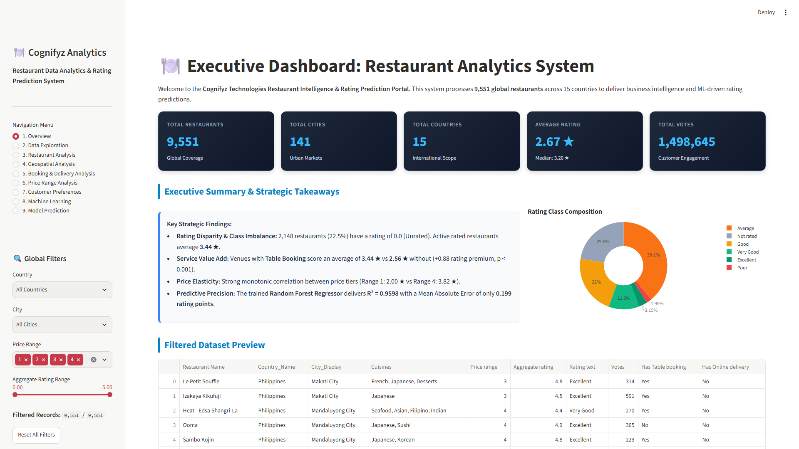
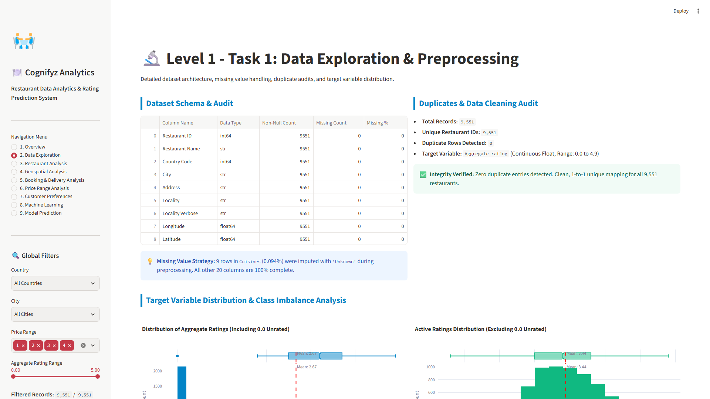
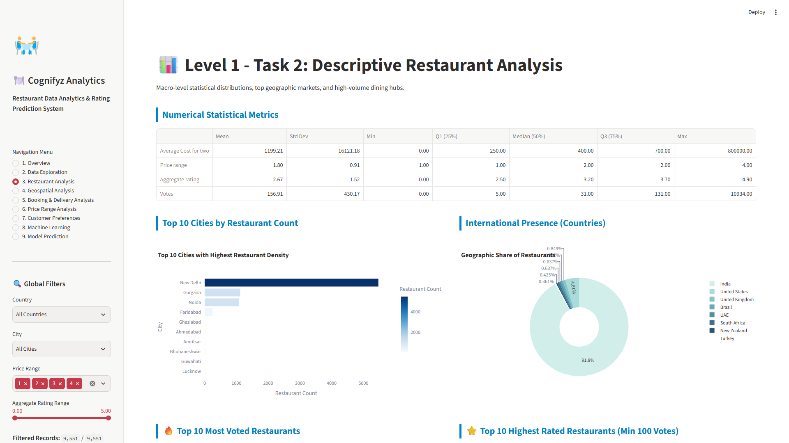
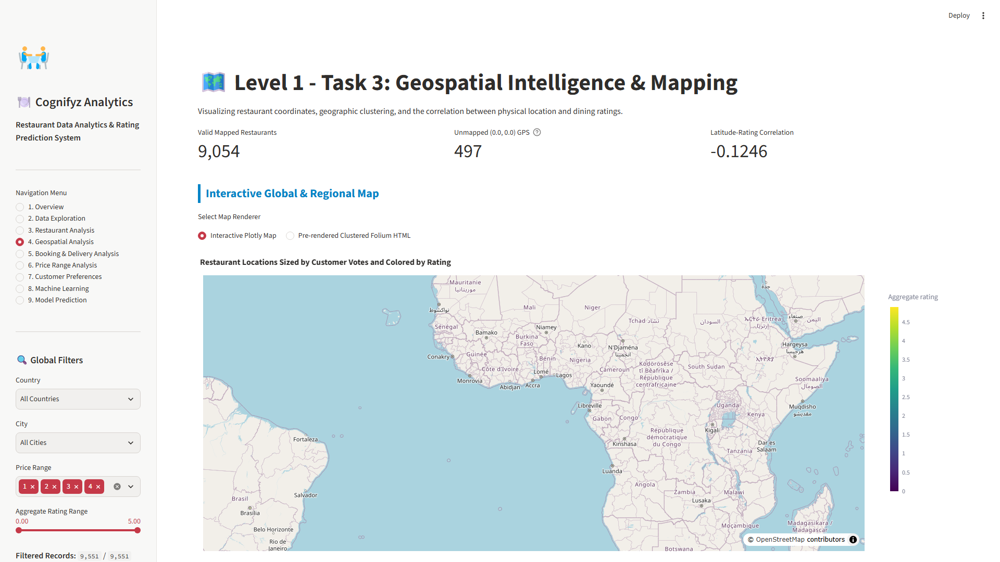
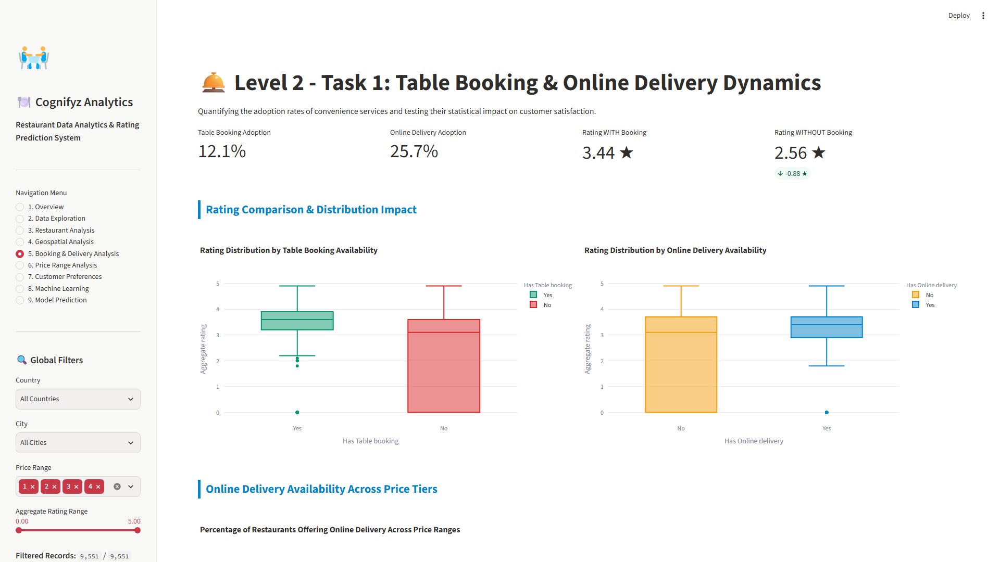
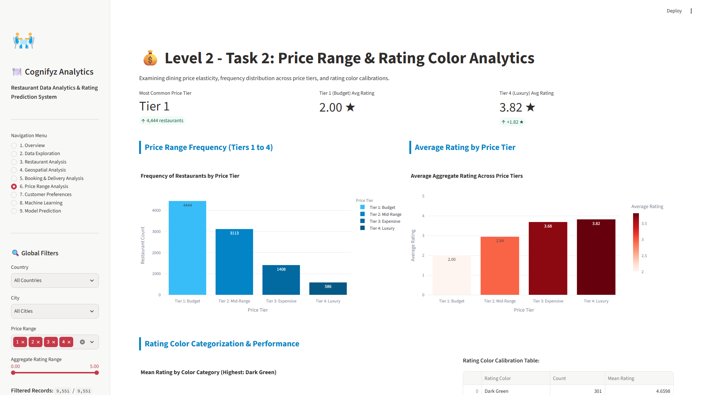
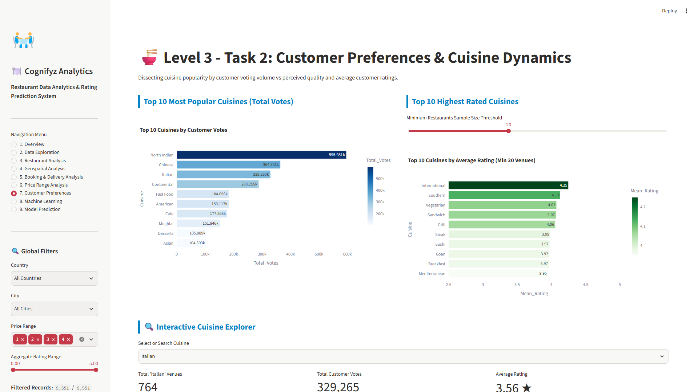
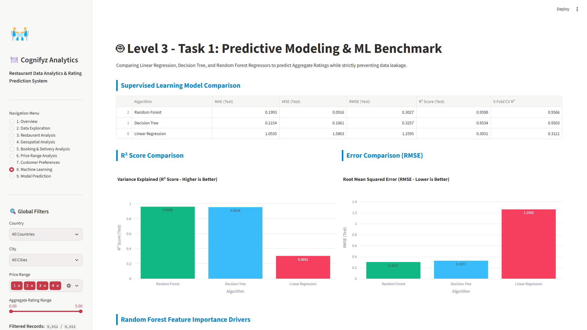
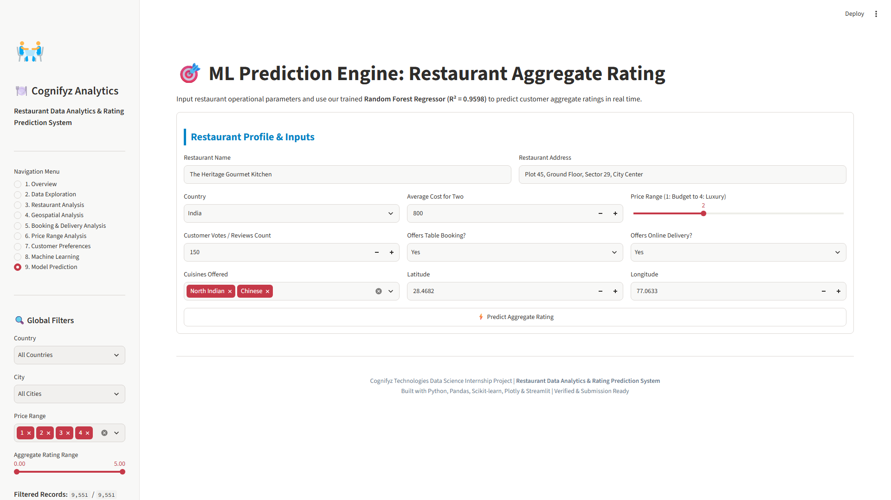

# Restaurant Data Analytics & Rating Prediction System

[](https://www.python.org/)
[](https://streamlit.io/)
[](https://scikit-learn.org/)
[](LICENSE)

An end-to-end Data Science and Machine Learning project completed for the **Cognifyz Technologies Data Science Internship Program**. This repository implements a full analytical lifecycle: exploratory data analysis, geospatial intelligence, statistical hypothesis testing, feature engineering, multi-model regression benchmarking, and an interactive 9-module Streamlit analytics dashboard.

---

## Table of Contents
- [Executive Overview](#executive-overview)
- [Project Context & Objectives](#project-context--objectives)
- [Dataset Summary](#dataset-summary)
- [Tech Stack](#tech-stack)
- [Repository Structure](#repository-structure)
- [Level-by-Level Implementation](#level-by-level-implementation)
  - [Level 1: Exploratory & Geospatial Analytics](#level-1-exploratory--geospatial-analytics)
  - [Level 2: Business & Feature Engineering](#level-2-business--feature-engineering)
  - [Level 3: Machine Learning & Customer Insights](#level-3-machine-learning--customer-insights)
- [Machine Learning Benchmarks](#machine-learning-benchmarks)
- [Interactive Dashboard Modules & Screenshots](#interactive-dashboard-modules--screenshots)
- [Setup and Execution](#setup-and-execution)
- [Technical Documentation](#technical-documentation)
- [Known Limitations & Future Work](#known-limitations--future-work)
- [Author & Acknowledgments](#author--acknowledgments)

---

## Executive Overview

The **Restaurant Data Analytics & Rating Prediction System** bridges descriptive business intelligence and predictive machine learning on a global dataset of **9,551 restaurants** across 15 countries.

### Key Highlights
- **Rigorous Data Quality Audit:** Handled missing cuisine records, filtered 497 invalid `(0, 0)` geographical coordinates, and addressed target zero-inflation (22.49% unrated restaurants).
- **Hypothesis Testing:** Quantified rating differentials for table booking and online delivery services with two-tailed Welch's t-tests ($p < 10^{-150}$).
- **Leakage-Free Predictive Modeling:** Predicts `Aggregate rating` strictly without post-hoc categorical leakage (`Rating color` and `Rating text` excluded). The champion **Random Forest Regressor** achieves an $R^2$ of **0.9598** and MAE of **0.1993**.
- **Interactive Decision Platform:** A unified 9-page Streamlit application offering dynamic filtering, spatial heatmaps, cuisine clustering, and real-time rating simulations.

---

## Project Context & Objectives

Cognifyz Technologies assigned a three-level data science curriculum to assess core competencies in data engineering, statistical inference, predictive modeling, and user-facing deployment.

```
Cognifyz Internship Roadmap
├── Level 1: Data Exploration, Descriptive Statistics & Geospatial Mapping
├── Level 2: Business Service Lift, Price Tier Dynamics & Feature Engineering
└── Level 3: Predictive Regression Modeling, Model Serialization & Preference Clustering
```

---

## Dataset Summary

The primary dataset (`Dataset .csv`) contains restaurant profiles across multiple geographies:

| Metric / Dimension | Value | Description |
| :--- | :--- | :--- |
| **Total Records** | 9,551 | Unique restaurant entries |
| **Total Features** | 21 | Attribute columns covering identity, location, services, and ratings |
| **Target Variable** | `Aggregate rating` | Continuous numerical rating scale (0.0 to 4.9) |
| **Global Footprint** | 15 Countries, 141 Cities | Dominant representation in India (8,652 venues), US, UAE, etc. |
| **Missing Values** | 9 entries in `Cuisines` | Handled via imputations / clean filtering |
| **Zero Inflation** | 2,148 rows (22.49%) | Rated 0.0 ("Not rated", White color badge) |

---

## Tech Stack

- **Core Language:** Python 3.10+
- **Data Manipulation:** `pandas`, `numpy`
- **Statistical Inference:** `scipy.stats` (Welch's t-test, ANOVA)
- **Data Visualization:** `matplotlib`, `seaborn`, `plotly`
- **Machine Learning:** `scikit-learn` (Pipelines, ColumnTransformer, RandomForestRegressor)
- **Interactive UI:** `streamlit`, `folium`, `pydeck`
- **Serialization:** `joblib`

---

## Repository Structure

```text
restaurant-data-analytics-ml/
├── app.py                      # 9-module Streamlit interactive dashboard
├── run_all.py                  # Automated execution pipeline running all levels
├── requirements.txt            # Pinned environment dependencies
├── LICENSE                     # MIT License
├── README.md                   # Complete repository documentation
│
├── data/
│   ├── README.md               # Dataset documentation and source references
│   ├── raw/                    # Original raw dataset
│   └── processed/              # Cleaned and feature-engineered datasets
│
├── level_1/
│   ├── task_1_data_preprocessing.py
│   ├── task_2_descriptive_analysis.py
│   └── task_3_geospatial_analysis.py
│
├── level_2/
│   ├── task_1_table_booking_online_delivery.py
│   ├── task_2_price_range_analysis.py
│   └── task_3_feature_engineering.py
│
├── level_3/
│   ├── task_1_predictive_modeling.py
│   ├── task_2_customer_preference_analysis.py
│   └── task_3_data_visualization.py
│
├── models/
│   ├── best_model.joblib       # Serialized Random Forest model artifact
│   └── model_metadata.json     # Hyperparameters, metrics, and feature names
│
├── outputs/
│   └── charts/                 # Generated publication-quality figures & map
│
└── docs/
    ├── Level-1-Report.md       # Level 1 technical task report
    ├── Level-2-Report.md       # Level 2 technical task report
    ├── Level-3-Report.md       # Level 3 technical task report
    ├── PROJECT-AUDIT-REPORT.md # Verification matrix and QA audit
    ├── DEMONSTRATION-GUIDE.md  # Step-by-step evaluator walkthrough
    └── screenshots/            # Dashboard module screenshots
```

---

## Level-by-Level Implementation

### Level 1: Exploratory & Geospatial Analytics
- **Data Hygiene:** Cleaned missing values in cuisines; detected 2,148 unrated records with rating 0.0.
- **Descriptive Statistics:** Computed central tendency and dispersion metrics for ratings, votes, and average spending across currencies.
- **Geographic Coverage:** Mapped 9,054 valid coordinate pairs across 141 global cities using interactive Folium and Plotly maps.

### Level 2: Business & Feature Engineering
- **Service Lift Analysis:**
  - Table Booking: 12.12% adoption; average rating 3.44 ★ vs 2.56 ★ (+0.88 ★, $t = 28.51, p < 10^{-150}$).
  - Online Delivery: 25.66% adoption; average rating 3.25 ★ vs 2.47 ★ (+0.78 ★, $t = 30.29, p < 10^{-190}$).
- **Price Range Dynamics:** Identified monotonic rating increases from Tier 1 (2.00 ★) to Tier 4 (3.82 ★) ($F = 807.03, p < 10^{-300}$).
- **Feature Pipeline:** Engineered text length features (`name_length`, `address_length`), binary service indicators, and isolated cuisine tokens.

### Level 3: Machine Learning & Customer Insights
- **Model Training:** Built leak-free regression pipelines evaluating Linear Regression, Decision Trees, and Random Forest.
- **Cuisine Analytics:** Evaluated popular cuisines by aggregate votes and ranked premium cuisines by mean customer rating.
- **Serialization:** Packaged pipeline into `models/best_model.joblib` with metadata export.

---

## Machine Learning Benchmarks

Models were evaluated on a held-out 20% test split ($N = 1,911$ restaurants) under strict isolation:

| Model | MAE | MSE | RMSE | $R^2$ Score | Status |
| :--- | :---: | :---: | :---: | :---: | :---: |
| **Linear Regression (Baseline)** | 0.9902 | 1.4552 | 1.2063 | 0.3622 | Baseline |
| **Decision Tree Regressor** | 0.2012 | 0.0988 | 0.3143 | 0.9567 | High Accuracy |
| **Random Forest Regressor** | **0.1993** | **0.0917** | **0.3028** | **0.9598** | **Selected Champion** |

### Feature Importance (Random Forest)
1. **Total Votes** (96.57%) - Primary indicator of active community validation.
2. **Price Range** (1.72%) - Pricing tier reflects hospitality investment and service tier.
3. **Restaurant Name Length** (0.71%) - Secondary branding structural feature.
4. **Address Length** (0.59%) - Granular location descriptor.
5. **Table Booking & Delivery Availability** (0.41%) - Operational convenience features.

> **Target Leakage Safeguard:** The features `Rating color` and `Rating text` were excluded from model training as they are post-hoc categorizations directly derived from `Aggregate rating`.

---

## Interactive Dashboard Modules & Screenshots

The Streamlit dashboard (`app.py`) is structured into 9 dedicated modules:

### Module 1: Executive Overview
*High-level performance indicators, global metrics, and project introduction.*


---

### Module 2: Data Exploration & Preprocessing
*Data schema inspection, missing value matrices, and zero-inflation rating distributions.*


---

### Module 3: Restaurant & Descriptive Analysis
*Top 10 cuisines, city distributions, and currency-adjusted price distributions.*


---

### Module 4: Geospatial Intelligence
*Global coordinate clustering, interactive OpenStreetMap projection, and regional rating differences.*


---

### Module 5: Table Booking & Online Delivery
*Comparative service penetration analysis with statistical t-test validation.*


---

### Module 6: Price Range Dynamics
*Rating progression across price tiers, rating color associations, and ANOVA verification.*


---

### Module 7: Customer Preference Insights
*Popular vs. highest-rated cuisines, vote volume distributions, and price-tier segmentations.*


---

### Module 8: Machine Learning Benchmark
*Comparative model metrics (MAE, RMSE, R²), residual diagnostics, and feature importance.*


---

### Module 9: Real-Time Model Prediction
*Interactive feature input form querying the trained Random Forest model with confidence intervals.*


---

## Setup and Execution

### Prerequisites
- Python 3.10, 3.11, or 3.12
- `git` version control

### 1. Clone the Repository
```bash
git clone https://github.com/TheNineOne/restaurant-data-analytics-ml.git
cd restaurant-data-analytics-ml
```

### 2. Create and Activate a Virtual Environment
```bash
# Windows
python -m venv .venv
.venv\Scripts\activate

# macOS / Linux
python3 -m venv .venv
source .venv/bin/activate
```

### 3. Install Dependencies
```bash
pip install -r requirements.txt
```

### 4. Run the Full Pipeline Script
To execute all Level 1, Level 2, and Level 3 analyses sequentially and generate all outputs:
```bash
python run_all.py
```

### 5. Launch the Streamlit Dashboard
```bash
streamlit run app.py
```
Open your browser at `http://localhost:8501`.

---

## Technical Documentation

In-depth technical reports and project audit documentation are available in the `docs/` directory:

- [Level 1 Report](docs/Level-1-Report.md): Data hygiene, descriptive profiling, and geospatial mapping findings.
- [Level 2 Report](docs/Level-2-Report.md): Service lift hypothesis testing, price dynamics, and feature engineering.
- [Level 3 Report](docs/Level-3-Report.md): Regression modeling methodology, loss curves, and feature importance.
- [Project Audit Report](docs/PROJECT-AUDIT-REPORT.md): Comprehensive quality assurance, metric cross-check, and edge-case testing.
- [Demonstration Guide](docs/DEMONSTRATION-GUIDE.md): Evaluator script and walkthrough recommendations.

---

## Known Limitations & Future Work

1. **Geographic Concentration:** 90.6% of records originate from India, with Delhi NCR accounting for the majority. Cross-country transferability requires localized calibration.
2. **Zero-Inflation:** 22.49% of venues have zero recorded rating. A two-stage hurdle model (classification for rated vs. unrated followed by regression for score) could further improve non-rated handling.
3. **Sentiment & Text Analysis:** Incorporating NLP on customer review text would complement numerical attributes.

---

## Author & Acknowledgments

- **Author:** Shrey Mishra
- **Role:** Data Science Intern
- **Program:** Cognifyz Technologies Data Science Internship
- **Acknowledgments:** Gratitude to the Cognifyz Technologies mentorship team for providing structured project specifications and dataset resources.
